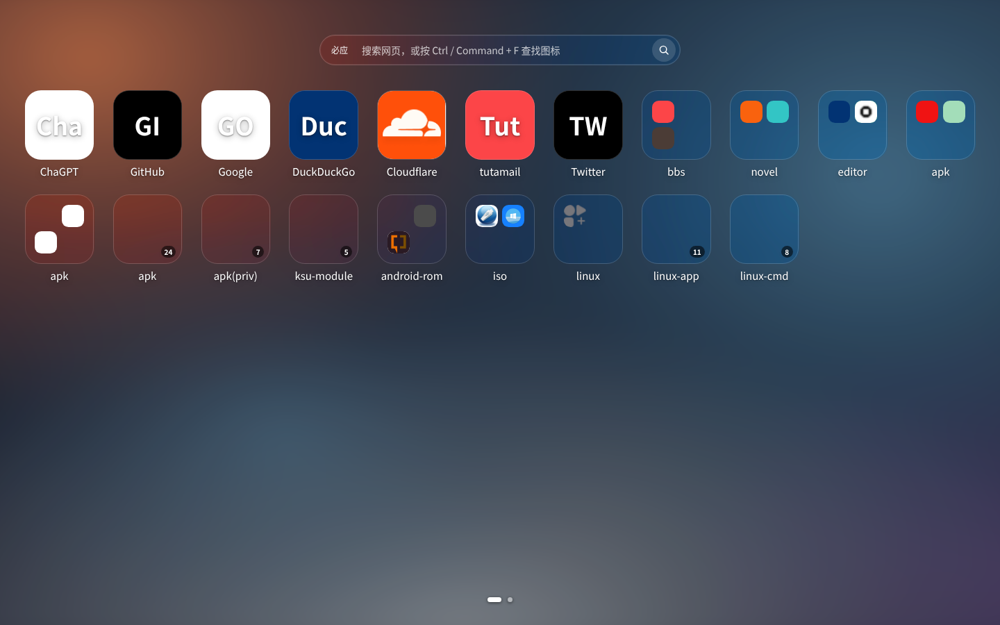
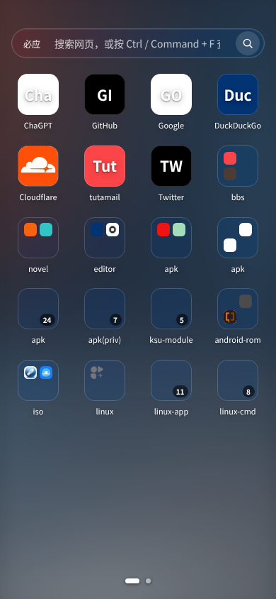
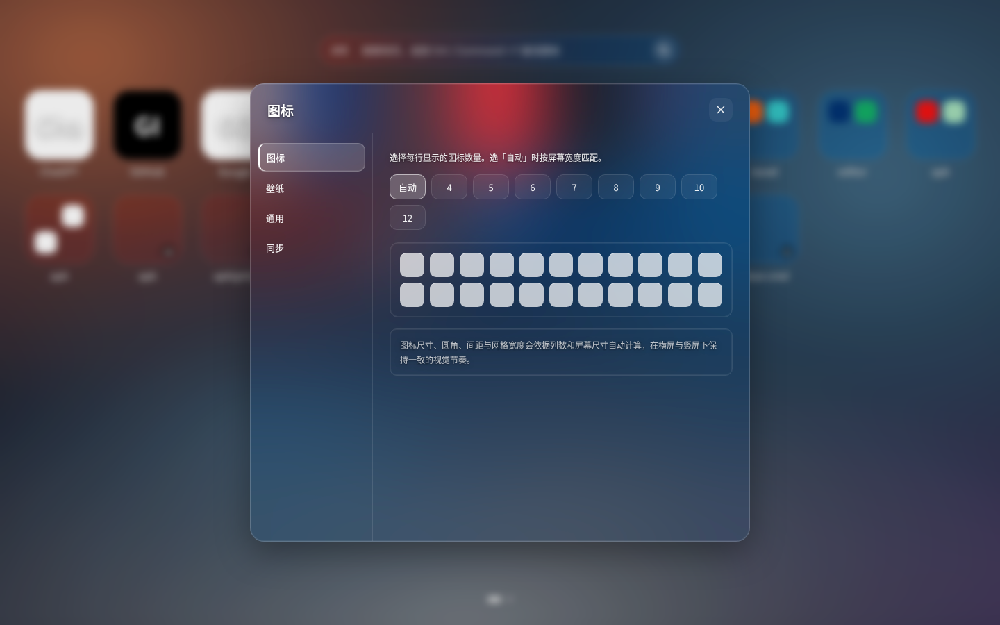
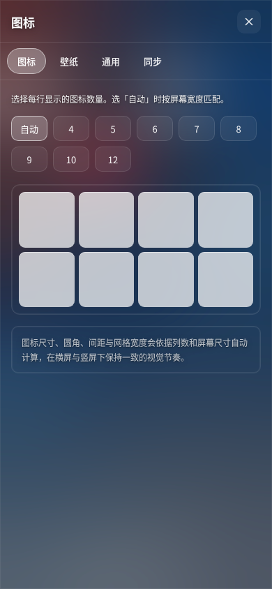

# NeoTab

[**中文**](README.md) · English

A browser new-tab extension built with plain HTML / CSS / JavaScript — no runtime dependencies, no build step.

A fully transparent, blurred interface with phone-style icon pages and optional WebDAV sync. Your data stays on your device by default: no accounts, no analytics, no backend services.

> This project is distributed as source. Load it from source using the steps under [Installation](#installation).

---

## Preview

| Desktop | Portrait | Settings · desktop | Settings · portrait |
| --- | --- | --- | --- |
|  |  |  |  |

The desktop screenshot above shows live favicon resolution: sites such as GitHub and Cloudflare display their real logos, while unreachable sites fall back to letter tiles. See also the [WebDAV sync panel](screenshots/08-settings-webdav.png) and [landscape settings](screenshots/03-settings-landscape.png). All screenshots are in [screenshots/](screenshots/).

## Features

- Icon grid: click to open, long-press for a menu (edit / size / delete), hold for two seconds to reorder with live reflow, hover over another icon to merge into a folder
- Folders, optional calendar / todo widgets, a notes panel (hidden by default)
- Phone-style pages: swipe, bottom dots, `←` / `→`, trackpad horizontal scroll; pages can be added, renamed, deleted and reordered
- Search bar (Bing by default; Baidu / Google / DuckDuckGo / 360 available) and `Ctrl`/`Command` + `F` to find icons and bookmarks
- Automatic favicon resolution with a local cache and graceful fallback; manual icon URLs or local image uploads are also supported
- Wallpaper: local image upload applied instantly, six built-in backgrounds, blur and dim controls; images can also be dropped onto the page
- Backup: import / export JSON
- Optional WebDAV sync: automatic backups, startup pull, cloud list with restore and delete

### How favicons are resolved

`js/05-icons.js` tries the following in order and stops at the first success; a letter tile is shown only when all fail:

| # | Source | Network behaviour |
| --- | --- | --- |
| 1 | A URL entered manually, or a locally uploaded image (`data:` URL) | None; local data wins |
| 2 | A previously verified URL cached in `localStorage` (30 days) | No extra probing |
| 3 | In extension context: Chrome's own `_favicon/?pageUrl=…&size=64/32` | Browser-local favicon cache; no `host_permissions` needed |
| 4 | The site's own `/favicon.ico`, `/apple-touch-icon.png`, `/apple-touch-icon-precomposed.png` | Requests go only to sites **you added** |
| 5 | `https://icons.duckduckgo.com/ip3/<domain>.ico` | **Off by default**; only sends the domain when explicitly enabled and all earlier steps failed |

Resolved URLs (not image bytes) are cached per domain in `localStorage`: 30 days on success, 30 minutes on failure. `0×0` placeholder images count as failures.

All controls live in **Settings → General → Site icons**: automatic resolution can be switched off entirely (leaving manual icons and letter tiles, with zero network requests), the public fallback service is off by default, and the cache can be cleared and rebuilt. Individual icons can be re-resolved from the context menu.

### WebDAV sync (optional)

| | |
| --- | --- |
| Enabling it | Enter a server address; the first connection requests `optional_host_permissions` on demand. HTTP Basic auth connects straight to your own server (some providers require an app password instead of the login password) |
| Files | `<address>/neotab-backup/` receives `neotab-<timestamp>.json` (manual) / `neotab-auto-<timestamp>.json` (automatic), plus an updated `latest.json`. The **10 most recent** automatic backups are kept; manual ones are never pruned |
| Automatic sync | Every change uploads after a **3-second debounce**; opening a new tab checks `latest.json` and applies a newer cloud copy, using a `_time` watermark to avoid two devices overwriting each other |
| Panel | Save config / test connection / back up now / cloud backup list (restore, delete, refresh). Restore asks for confirmation and reloads on success; 401/403 and cross-origin redirects have dedicated error messages |

Server address, username, app password and the `lastSync` watermark are stored in the browser's `localStorage` under `webdavConfig` and are sent only to the server you configured. Backups contain pages, icons, folders, settings, notes and todos; **wallpaper images are not uploaded** (they live in local IndexedDB), though wallpaper type / preset / blur / dim are synced, so a new device needs the local image selected once more.

> Import and cloud restore accept only backups exported by this project (`format: "neotab"`).

## Installation

Requires a Chromium-based browser with Manifest V3 support (Chrome / Edge / Brave, etc.). Firefox uses a different permissions model and is not currently supported.

```bash
git clone https://github.com/AlexIllinois2/neotab.git
cd neotab
```

Alternatively, download a ZIP from the [repository page](https://github.com/AlexIllinois2/neotab).

1. Open `chrome://extensions` and enable **Developer mode**
2. Click **Load unpacked** and select the repository root
3. Open a new tab

You can also preview it **without installing**: serve the repository root with any static server (for example `python3 -m http.server 8000`) and open `http://localhost:8000/newtab.html`. The page falls back to `localStorage` + IndexedDB. Web mode cannot use Chrome's `_favicon` cache, but still requests each site's own favicon; installing as an extension makes this faster and more complete.

## Usage

- Swipe / bottom dots / `←` `→` / trackpad horizontal scroll → switch pages
- Long-press an icon → menu (open / edit / size / delete); keep holding for two seconds → the icon lifts and can be dragged to reorder (others reflow live). Drop it onto another icon after hovering to merge into a folder. `Esc` closes overlays
- Long-press or right-click empty space → add an icon (including bulk import from bookmarks) / widget, create a page, change wallpaper
- **Settings** has four tabs: Icons (column count), Wallpaper, General, Sync
- Enter a WebDAV address under **Settings → Sync** to enable automatic backups; leave it empty to stay strictly local
- **Settings → General** toggles the clock, search bar and notes entry, creates pages, and controls favicon resolution and cache clearing
- Right-click an icon → **Re-resolve favicon**; editing an icon accepts an image URL or a local upload
- `Ctrl`/`Command` + `F` to search, `Esc` to close overlays

## Privacy & permissions

| Permission | Purpose |
| --- | --- |
| `storage` | Save settings, pages, icons and notes |
| `bookmarks` | The user-triggered "bulk import from bookmarks" dialog and global search |
| `favicon` | Read the browser's local favicon cache (`_favicon`), with a letter tile as fallback |
| `unlimitedStorage` | Local wallpapers (compressed into IndexedDB) |
| `optional_host_permissions` (`http://*/*`, `https://*/*`) | **Not granted by default.** Requested once for the specific host when a WebDAV address is entered and first connected; revocable at any time in `chrome://extensions` |

There are no always-on `host_permissions`, no background service, no content scripts, no accounts, no analytics and no uploads to any built-in server. Wallpapers come from local uploads or bundled SVG / CSS gradients; search engines are only opened when you submit a query.

**Network behaviour**: With automatic favicon resolution on (the default), the page requests favicons from the sites you added, equivalent to the browser loading those icons; results are cached locally in `localStorage`. The public fallback service is off by default. WebDAV sync is unconfigured and makes no requests until you set an address, after which it talks only to that server using HTTP Basic credentials. For strictly zero network requests, turn off automatic favicon resolution in **Settings → General** and leave the sync address empty.

## Project layout

```
manifest.json          MV3 manifest
newtab.html             Page skeleton (static DOM; JS fills dynamic content)
css/base.css            Design tokens, transparent + blur gradients, shared controls and overlays
css/layout.css          Page swiping, icon grid, dots, drag states
css/settings.css        Responsive settings panel
js/00-core.js           Utilities and event bus
js/05-icons.js          Multi-level favicon resolution, cache, fallback
js/10-storage.js        chrome.storage / localStorage + IndexedDB adapter
js/20-state.js          State model, built-in site list, backup decoding
js/30-wallpaper.js      Wallpaper (instant upload, blur, dim)
js/40-grid.js           Icon grid rendering, adaptive layout, long-press menu and drag sorting
js/50-desks.js          Horizontal paging, swipe engine, dots, edit mode
js/60-search.js         Search bar, clock, global find, notes
js/70-settings.js       Settings panel (column count is the only adjustable grid setting)
js/80-dialogs.js        Forms, context menus, folders, bookmark import
js/85-webdav.js         WebDAV backup and sync (rotation, multi-device pull, embedded settings panel)
js/90-app.js            Startup and render coordination
assets/                 Hand-drawn default wallpaper SVG
icons/                  Hand-drawn logo (SVG + PNG)
tools/make-icons.py     Regenerate PNGs from SVG (requires Pillow; only after editing the logo)
tools/smoke.py          Optional real-browser smoke test (Python 3.10+, websockets, local Chrome)
screenshots/            Interface screenshots
```

## Development

No `npm install`, no bundling. Edit and reload the tab to see changes.

```bash
python3 tools/smoke.py                 # 58 checks across three viewports: grid coverage, icon resolution, long-press drag sorting, WebDAV sync, zero console errors
python3 tools/smoke.py --shots screenshots  # also write 6 interface screenshots to screenshots/
python3 tools/make-icons.py            # only after editing icons/logo.svg
```

`tools/smoke.py` loads the page in headless local Chrome and checks layout, paging, transparency and blur gradients, swipe behaviour, the long-press menu and two-second drag sorting, grid coverage and icon size, adaptive column count, responsive settings, instant wallpaper upload, favicon resolution and cache fallback, backup import, and console errors. Its WebDAV section injects an in-memory WebDAV server (no real requests) covering Basic auth, `MKCOL/PROPFIND/PUT/GET/DELETE`, directory creation and retry, the 3-second debounce, 10-file rotation, startup pull, 401 diagnostics and portrait layout. It is a development tool only; running the extension does not require Python.

## Feedback & contributions

Please [open an issue](https://github.com/AlexIllinois2/neotab/issues) for bugs or feature requests; including the browser version, reproduction steps and a screenshot helps. Pull requests are welcome: JS / CSS changes need no build step, just reload the tab. If you change the interface or interactions, please update `screenshots/` and the corresponding documentation.

Consider running the smoke test locally before submitting (see [Development](#development)). There is no lint or formatter config; please follow the existing code style.

## Declaration

This project was independently designed and written by its author. The interface, state model, storage layer and icon resolution are original implementations; no code, trademarks, icons, fonts or wallpaper assets from any third-party extension were used. The SVG sources for the hand-drawn icons and wallpaper, together with the generation scripts, are kept in this repository for reference.

This project is not affiliated with, authorised, endorsed by, or representative of any third-party new-tab product. All files in this repository are licensed under the MIT License (see [LICENSE](LICENSE)).

If you believe any content in this repository infringes your rights, please [open an issue](https://github.com/AlexIllinois2/neotab/issues); we will review it and remove or correct the material where confirmed.

## License

MIT, see [LICENSE](LICENSE).
