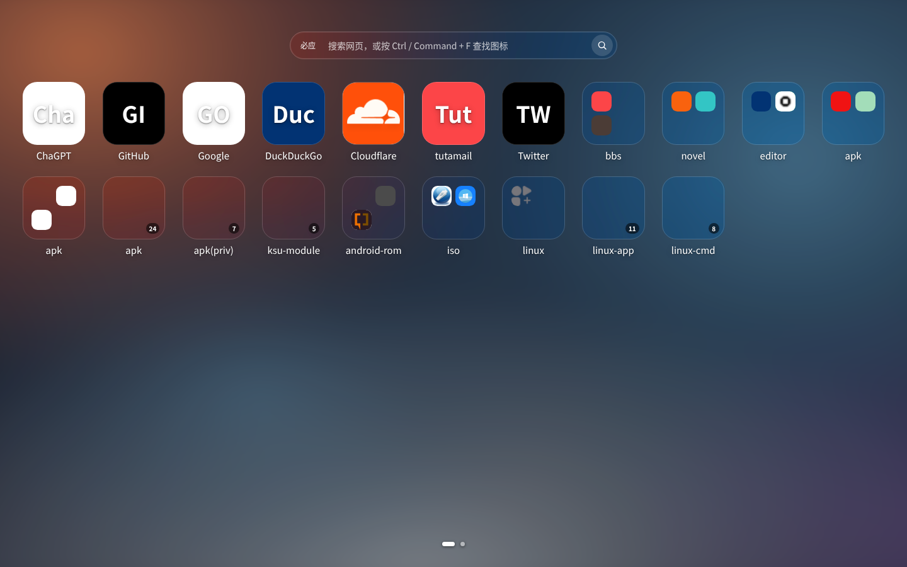
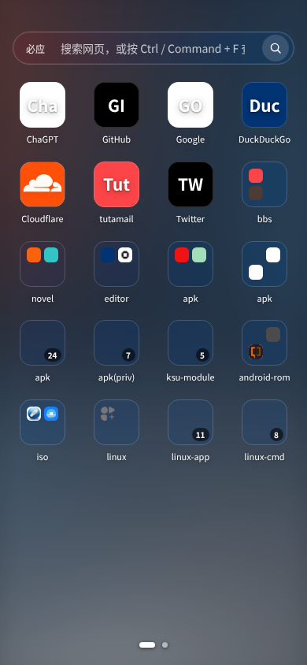
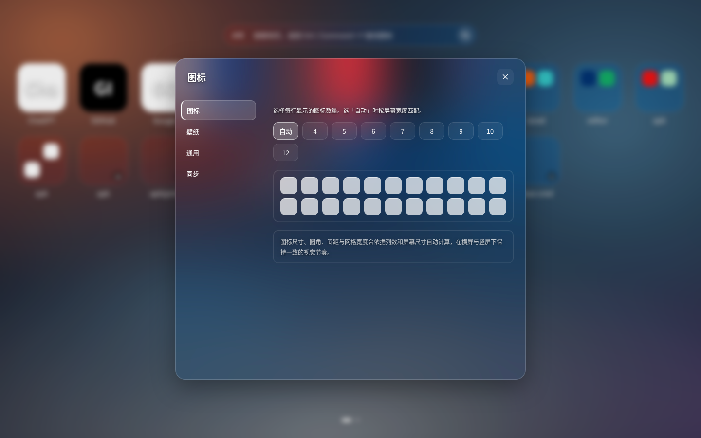
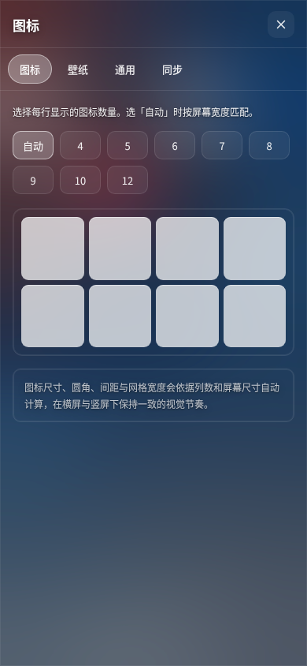

# NeoTab

[English](README.en.md) · **中文**

一个浏览器新标签页扩展：**原生 HTML / CSS / JavaScript，零运行时、零构建**。

全站透明 + 高斯模糊、手机桌面式图标分页、可选的 WebDAV 同步；数据默认只存在本机，无账号、无统计、无后台服务。

> 本项目以源码形式提供，按下方「安装」从源码加载即可使用。

---

## 预览

| 桌面主界面 | 手机竖屏 | 设置页 · 桌面 | 设置页 · 手机竖屏 |
| --- | --- | --- | --- |
|  |  |  |  |

主界面截图里可以看到站点图标自动解析的实际效果：GitHub / Cloudflare 等显示真实 logo，取不到时回退文字色块。WebDAV 同步面板见 [08-settings-webdav.png](screenshots/08-settings-webdav.png)，横屏设置页见 [03-settings-landscape.png](screenshots/03-settings-landscape.png)；其余截图见 [screenshots/](screenshots/) 目录。

## 功能

- 图标网格：点击打开、长按弹菜单（编辑 / 尺寸 / 删除）、按住 2 秒拖动排序（实时让位）、悬停合并文件夹
- 文件夹、日历 / 待办小组件（可选）、便签面板（默认隐藏）
- 手机桌面式分页：跟手滑动 / 底部圆点 / `←` `→` / 触摸板横扫；桌面可新建、重命名、删除、排序
- 搜索栏（默认必应，可切百度 / Google / DuckDuckGo / 360）、`Ctrl` `Command` + `F` 全局查找图标与书签
- 站点图标：多级自动解析（本地缓存 → 浏览器 `_favicon` → 站点自身 `favicon.ico` / `apple-touch-icon` → 可选公共服务），带缓存与失败回退；也可手动填图标地址或上传本地图片，详见下节
- 壁纸：本地图片上传即生效、6 款内置背景、模糊度、遮罩浓度；也可把图片直接拖到页面
- 备份：导入导出 JSON
- WebDAV 同步（可选）：自动备份 / 启动拉取 / 云端列表恢复与删除

### 站点图标自动解析

`js/05-icons.js` 为每个链接图标按以下顺序依次尝试，任一成功即停止，全部失败才显示文字色块：

| 顺序 | 来源 | 网络行为 |
| --- | --- | --- |
| 1 | 图标上手动填写的地址 / 上传的本地图片（`data:` URL） | 无（本地数据优先） |
| 2 | `localStorage` 中已验证成功的 URL（30 天） | 无额外探测 |
| 3 | 扩展环境：Chrome 自带 `_favicon/?pageUrl=…&size=64/32` | 浏览器本地 favicon 缓存，不需要 `host_permissions` |
| 4 | 站点自身的 `/favicon.ico`、`/apple-touch-icon.png`、`/apple-touch-icon-precomposed.png` | 只访问**你添加的站点**，等价于浏览器加载该站图标 |
| 5 | `https://icons.duckduckgo.com/ip3/<域名>.ico` | **默认关闭**，仅前四种都失败且显式开启后才把域名发给该服务 |

解析结果（URL，不含图片字节）按域名缓存在 `localStorage`：成功 30 天、失败 30 分钟，避免每次开新标签页重复探测。`0×0` 的占位图视为失败。

可控点都在「设置 → 通用 → 站点图标」：**自动解析网站图标** 一键完全关闭（此时只剩手动图标与文字色块，页面零网络请求）；**公共图标服务兜底** 默认关闭；**清除缓存并重新解析** 立即重来。单个图标可在右键菜单点「重新解析网站图标」，编辑图标时可填任意图标地址或上传本地 PNG。

> 为什么不用「抓取网页 HTML 解析 `<link rel=icon>`」：普通网页受 CORS 限制无法跨域读取；扩展要做则需申请 `<all_urls>` 主机权限（会被 Chrome 标为「读取和更改所有网站上的所有数据」），代价远高于收益。因此改用站点根目录约定文件 + 苹果触摸图标拿较清晰的图，并保留手动覆盖通道。

### WebDAV 同步（可选）

| | |
| --- | --- |
| 启用条件 | 填写服务地址后首次连接按需申请 `optional_host_permissions`，HTTP Basic 认证直连你自己的服务器（坚果云需在网页端「安全选项」生成应用密码，不能用登录密码） |
| 目录与文件 | `<地址>/neotab-backup/`：每次写 `neotab-<时间戳>.json`（手动）/ `neotab-auto-<时间戳>.json`（自动），同时更新 `latest.json`。自动备份**保留最近 10 份**，手动备份永不清理 |
| 自动同步 | 任何数据变更后 **3 秒防抖**自动上传；打开新标签页时检查 `latest.json`，云端有更新版本才应用到本地，用 `_time` 水位避免两台设备来回覆盖 |
| 面板 | 「保存配置 / 测试连接 / 备份到云端 / 云端备份列表（恢复、删除、刷新）」；恢复前二次确认，成功后刷新页面。401/403/跨域重定向有专门的错误提示 |

配置（服务器地址、用户名、应用密码、同步水位 `lastSync`）存在浏览器 `localStorage` 的 `webdavConfig` 键，只发往你填写的服务器。备份内容包含桌面、图标、分组、设置、便签与待办；**壁纸图片本身不上传**（它只存在本机 IndexedDB），但壁纸类型 / 预设 / 模糊度 / 遮罩会同步，换设备后需要重新选一次本地图片。

> 导入与云端恢复只接受本项目导出的备份文件（`format: "neotab"`）。

## 安装

需要支持 Manifest V3 的 Chromium 系浏览器（Chrome / Edge / Brave 等）；Firefox 的权限模型不同，暂未适配。

```bash
git clone https://github.com/AlexIllinois2/neotab.git
cd neotab
```

也可以从[仓库页面](https://github.com/AlexIllinois2/neotab)下载 ZIP 解压。

1. 打开 `chrome://extensions`，启用右上角「开发者模式」
2. 点「加载已解压的扩展程序」，选择仓库根目录
3. 新建标签页即可

也可以**不装扩展**直接预览：用任意静态服务器打开仓库根目录（例如 `python3 -m http.server 8000`），访问 `http://localhost:8000/newtab.html`；页面会自动降级为 `localStorage` + IndexedDB 存储。网页模式下拿不到浏览器 `_favicon` 缓存，但仍会自动请求站点自身的 favicon（受网络与站点配置影响，取不到就回退文字色块）；装成扩展后由浏览器本地缓存提供，更快也更完整。

## 使用

- 左右滑动 / 底部圆点 / `←` `→` / 触摸板横扫 → 切换桌面
- 长按图标 → 弹出菜单（打开 / 编辑 / 尺寸 / 删除）；按住不放满 2 秒 → 图标抬起放大，可拖动排序（其他图标实时让位，松手落位），拖到其他图标上悬停片刻松手即合并为文件夹；`Esc` 关闭弹层
- 长按或右键空白处 → 添加图标（内含从书签批量导入）/ 添加小组件、新建桌面、换壁纸
- 长按 / 右键空白处 → 菜单（添加图标、添加小组件、更换壁纸、设置）；设置里图标（列数）、壁纸、通用、同步
- 「设置 → 同步」填 WebDAV 地址即可启用自动备份；不填就始终保持纯本地
- 「设置 → 通用」可打开时钟、搜索栏、便签入口，并新建桌面；也可开关站点图标自动解析、清除图标缓存
- 图标右键 →「重新解析网站图标」；编辑图标可填图标地址或上传本地图片
- `Ctrl/Command + F` 查找，`Esc` 关闭弹层

## 隐私与权限

| 权限 | 用途 |
| --- | --- |
| `storage` | 保存配置、桌面、图标、便签 |
| `bookmarks` | 用户主动触发的「从书签批量导入」（添加图标对话框）和全局查找 |
| `favicon` | 读取浏览器本地的网站图标缓存（`_favicon`），失败时回退文字图标 |
| `unlimitedStorage` | 本地壁纸（压缩后存 IndexedDB，不会超过配额） |
| `optional_host_permissions`（`http://*/*`、`https://*/*`） | **默认不生效**。仅在「设置 → 同步」填写 WebDAV 地址并首次连接时，向该站点单独申请一次访问权，可在 `chrome://extensions` 里随时撤销 |

没有**固定生效**的 `host_permissions`、没有后台服务、没有内容脚本、没有账号、没有统计、不向任何内置服务器上传数据。壁纸来自本地上传或内置 SVG / CSS 渐变，搜索引擎只在用户提交搜索时跳转。

**关于网络请求**：默认开启「自动解析网站图标」时，页面会向你添加的站点自身请求 favicon（与浏览器加载该站图标等价），结果只缓存在本机 `localStorage`。第三方公共服务默认关闭。WebDAV 同步默认不配置、不发任何请求；填写地址后只与你自己那台服务器通信，用 HTTP Basic 发送用户名 / 应用密码。若希望严格零网络请求，在「设置 → 通用」关掉「自动解析网站图标」并保持「设置 → 同步」的地址为空即可。

## 目录

```
manifest.json          MV3 清单
newtab.html            页面骨架（静态 DOM，JS 只填充动态内容）
css/base.css           设计变量、透明 + 模糊梯度、通用控件、弹层
css/layout.css         手机桌面分页、图标网格、圆点、拖动态
css/settings.css       响应式设置面板
js/00-core.js          工具函数与事件总线
js/05-icons.js         站点图标多级解析、缓存、失败回退
js/10-storage.js       chrome.storage / localStorage + IndexedDB 适配
js/20-state.js         状态模型、内置站点清单、备份解码
js/30-wallpaper.js     壁纸（上传即生效、模糊、遮罩）
js/40-grid.js          图标网格渲染、自适应计算、长按菜单与拖动排序
js/50-desks.js         横向分页、跟手滑动引擎、圆点、编辑模式
js/60-search.js        搜索栏、时钟、全局查找、便签
js/70-settings.js      设置面板（列数唯一可调）
js/80-dialogs.js       表单、右键菜单、文件夹、书签导入
js/85-webdav.js        WebDAV 备份与同步（独立实现：备份轮换、多设备拉取、内嵌设置面板）
js/90-app.js           启动与渲染协调
assets/                自绘默认壁纸 SVG
icons/                 自绘 Logo（SVG + PNG）
tools/make-icons.py    由 SVG 重出 PNG（需 Pillow，仅改 Logo 时用）
tools/smoke.py         可选的真浏览器冒烟测试（Python 3.10+、websockets、本机 Chrome）
screenshots/           界面截图
```

## 开发

没有 `npm install`，没有打包。改完刷新标签页即可生效。

```bash
python3 tools/smoke.py                 # 冒烟测试：58 项，含三种视口、网格铺满度、图标解析、长按拖动排序、WebDAV 同步与控制台零报错
python3 tools/smoke.py --shots screenshots  # 额外输出 6 张界面截图到 screenshots/
python3 tools/make-icons.py            # 仅在修改 icons/logo.svg 后重出 PNG
```

`tools/smoke.py` 用本机 Chrome 无头加载页面，检查无侧栏、三页分页、全局透明 + 模糊梯度、跟手滑动、长按菜单、长按 2 秒拖动排序（抬起放大、实时让位、松手落位、拖动不改壁纸）、网格铺满度与图标尺寸、自适应列数、设置页响应式、壁纸上传即生效、站点图标多级解析与缓存回退、备份导入和控制台错误。WebDAV 部分在页面内注入一个内存 WebDAV 服务器（不发真实请求），覆盖 Basic 认证、`MKCOL/PROPFIND/PUT/GET/DELETE`、目录缺失自动创建后重传、3 秒防抖自动上传、10 份轮换、启动拉取、401 诊断、竖屏自适应。它只是开发期工具，扩展运行不需要 Python。

## 反馈与贡献

发现问题或有功能建议，请在 [Issues](https://github.com/AlexIllinois2/neotab/issues) 提交；附上浏览器版本、复现步骤与截图会更利于定位。欢迎 Pull Request：改动 JS / CSS 后无需构建，刷新标签页即可验证；若调整了界面或交互，请一并更新 `screenshots/` 和本文档的对应说明。

提交前可本地跑一次冒烟测试（见「开发」）。项目没有 lint / 格式化配置，保持现有代码风格即可。

## 声明

本项目由作者独立设计与编写：界面、状态模型、存储层与图标解析均为原创实现，未引入任何第三方扩展的代码、商标、图标、字体或壁纸素材。仓库内自绘图标与壁纸的 SVG 源文件、生成脚本一并保留，可供核对。

本项目与任何第三方新标签页产品均无关联，未获其授权、认可或背书，也不代表其立场。仓库内全部文件按 MIT 许可证授权（见 [LICENSE](LICENSE)）。

若认为本仓库中某处内容涉及您的合法权益，请在 [Issues](https://github.com/AlexIllinois2/neotab/issues) 告知；我们会核实，并在确认后移除或更正。

## 许可

MIT，见 [LICENSE](LICENSE)。
